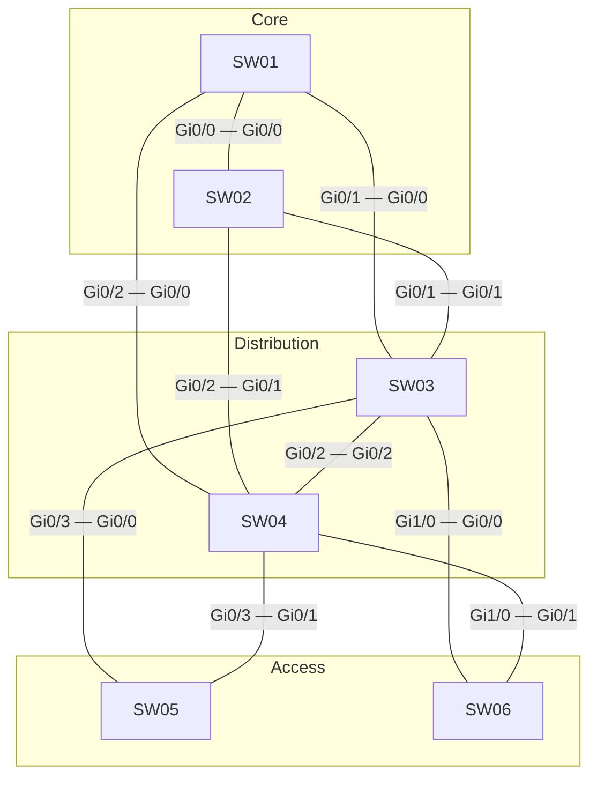

# Question 20261008-016

> **Answer this question without connecting to any device. No additional show commands may be run.**

## Scenario



| Switch | Interface (port number) | Neighbor switch | Neighbor interface (port number) |
|---|---|---|---|
| SW01 | Gi0/0(1) | SW02 | Gi0/0(1) |
| SW01 | Gi0/1(2) | SW03 | Gi0/0(1) |
| SW01 | Gi0/2(3) | SW04 | Gi0/0(1) |
| SW02 | Gi0/1(2) | SW03 | Gi0/1(2) |
| SW02 | Gi0/2(3) | SW04 | Gi0/1(2) |
| SW03 | Gi0/2(3) | SW04 | Gi0/2(3) |
| SW03 | Gi0/3(4) | SW05 | Gi0/0(1) |
| SW03 | Gi1/0(5) | SW06 | Gi0/0(1) |
| SW04 | Gi0/3(4) | SW05 | Gi0/1(2) |
| SW04 | Gi1/0(5) | SW06 | Gi0/1(2) |

| Switch | Role | Bridge priority (VLAN 30) | Bridge priority (VLAN 110) | MAC address |
|---|---|---|---|---|
| SW01 | Core CR1 | 36864 | 36864 | a0cf.5b12.a21f |
| SW02 | Core CR2 | 24576 | 24576 | 0023.04a1.8e39 |
| SW03 | Distribution DS1 | 32768 | 32768 | 0019.e8f3.5426 |
| SW04 | Distribution DS2 | 28672 | 28672 | 0019.e8a0.68f4 |
| SW05 | Access AS1 | 36864 | 36864 | a0cf.5b7f.f7c9 |
| SW06 | Access AS2 | 32768 | 32768 | 001a.a1eb.5881 |

All switches run Rapid PVST+, and the path cost uses the short method on all of them. All links between the switches are 1 Gbps full-duplex trunks that carry VLAN 30 and VLAN 110. The port ID consists of the port priority (default 128) and the port number.

SW03 and SW04 have SVIs for VLAN 30 and VLAN 110 and provide default gateway redundancy with HSRP. The core performs L2 forwarding only. The access switches do not route.

```
SW03(config)# ip routing
SW03(config)# interface Vlan30
SW03(config-if)# ip address 10.107.30.3 255.255.255.0
SW03(config-if)# standby version 2
SW03(config-if)# standby 30 ip 10.107.30.254
SW03(config)# interface Vlan110
SW03(config-if)# ip address 10.107.110.3 255.255.255.0
SW03(config-if)# standby version 2
SW03(config-if)# standby 110 ip 10.107.110.254
SW03(config-if)# standby 110 priority 110
SW03(config-if)# standby 110 preempt
```

```
SW04(config)# ip routing
SW04(config)# interface Vlan30
SW04(config-if)# ip address 10.107.30.4 255.255.255.0
SW04(config-if)# standby version 2
SW04(config-if)# standby 30 ip 10.107.30.254
SW04(config)# interface Vlan110
SW04(config-if)# ip address 10.107.110.4 255.255.255.0
SW04(config-if)# standby version 2
SW04(config-if)# standby 110 ip 10.107.110.254
SW04(config-if)# standby 110 preempt
```

| Host | VLAN | Connected to | IP address | Default gateway |
|---|---|---|---|---|
| PC-A | 30 | SW05 | 10.107.30.101/24 | 10.107.30.254 |
| PC-B | 110 | SW06 | 10.107.110.102/24 | 10.107.110.254 |

SW03 and SW04 booted at the same time, and there have been no configuration changes or failures since then.
Assume that ARP and MAC address learning are complete.

## Question

A ping is run once from PC-A to PC-B. Select the switches that the echo request (forward path) and the echo reply (return path) pass through, in order, starting from the access switch on the PC side. If the same switch is passed through twice, enter it each time, and once the path has ended, select "— (ends here)" for the remaining cells. In addition, select the device that routes the forward path and the device that routes the return path. **You score only if all of ① through ⑱ are selected correctly.**

### Answer Table

| Item | 1 | 2 | 3 | 4 | 5 | 6 | 7 | 8 |
|---|---|---|---|---|---|---|---|---|
| Forward path | ［①］ | ［②］ | ［③］ | ［④］ | ［⑤］ | ［⑥］ | ［⑦］ | ［⑧］ |
| Return path | ［⑨］ | ［⑩］ | ［⑪］ | ［⑫］ | ［⑬］ | ［⑭］ | ［⑮］ | ［⑯］ |

| Item | Selection |
|---|---|
| Device that routes the forward path | ［⑰］ |
| Device that routes the return path | ［⑱］ |

## Choices

A. SW01

B. SW02

C. SW03

D. SW04

E. SW05

F. SW06

G. — (ends here)
