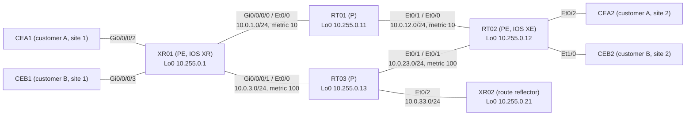

# Question 20261107-002

> **Answer this question without connecting to any device. No additional show commands may be run.**

## Scenario



The core is in AS 65000 and runs IS-IS (with the metrics shown in the diagram) and LDP. XR02 is the VPNv4 route reflector, and XR01 and RT02 have VPNv4 sessions with XR02 only. RT01 and RT03 do not run BGP.

| Site | Attached to | VRF | LAN |
|---|---|---|---|
| Customer A, site 1 (CEA1) | XR01 Gi0/0/0/2 | CUST-A | 10.101.1.0/24 (public segment 198.51.100.0/25) |
| Customer A, site 2 (CEA2) | RT02 Et0/2 | CUST-A | 10.101.2.0/24 (public segment 198.51.100.128/25) |
| Customer B, site 1 (CEB1) | XR01 Gi0/0/0/3 | CUST-B | 10.102.1.0/24 |
| Customer B, site 2 (CEB2) | RT02 Et1/0 | CUST-B | 10.102.2.0/24 |

XR01 also connects to the shared-services servers (VRF SVC, Gi0/0/0/4) and to the Internet (global routing table).

CEA1 pings CEA2 (10.101.2.1) over the L3VPN. The following output was collected at that time (some lines are omitted).

```
RP/0/RP0/CPU0:XR01#show bgp vrf CUST-A labels
   Network            Next Hop        Rcvd Label      Local Label
Route Distinguisher: 10.255.0.1:101 (default for vrf CUST-A)
Route Distinguisher Version: 42
*> 0.0.0.0/0          192.0.2.2       nolabel         24009
*> 10.101.1.0/24      172.16.11.2     nolabel         24004
*>i10.101.2.0/24      10.255.0.12     22              nolabel
*> 198.51.100.0/25    172.16.11.2     nolabel         24005
*>i198.51.100.128/25  10.255.0.12     23              nolabel
```

```
RP/0/RP0/CPU0:XR01#show mpls forwarding
Local  Outgoing    Prefix             Outgoing     Next Hop        Bytes
Label  Label       or ID              Interface                    Switched
------ ----------- ------------------ ------------ --------------- ------------
24000  20          10.255.0.21/32     Gi0/0/0/1    10.0.3.13       1854
24001  Pop         10.255.0.13/32     Gi0/0/0/1    10.0.3.13       580
24002  16          10.255.0.12/32     Gi0/0/0/0    10.0.1.11       10528
24003  Pop         10.255.0.11/32     Gi0/0/0/0    10.0.1.11       402
24004  Unlabelled  10.101.1.0/24[V]   Gi0/0/0/2    172.16.11.2     0
24005  Unlabelled  198.51.100.0/25[V] Gi0/0/0/2    172.16.11.2     0
24006  Unlabelled  10.102.1.0/24[V]   Gi0/0/0/3    172.16.21.2     0
24007  Unlabelled  10.99.1.0/24[V]    Gi0/0/0/4    172.16.91.2     500
24008  Unlabelled  10.99.2.0/24[V]    Gi0/0/0/4    172.16.91.2     0
24009  Aggregate   CUST-A: Per-VRF Aggr[V]   \
                                      CUST-A                       2000
```

```
RT01#show mpls forwarding-table
Local      Outgoing   Prefix           Bytes Label   Outgoing   Next Hop
Label      Label      or Tunnel Id     Switched      interface
16         Pop Label  10.255.0.12/32   12438         Et0/1      10.0.12.12
17         Pop Label  10.0.23.0/24     0             Et0/1      10.0.12.12
18         24001      10.255.0.13/32   0             Et0/0      10.0.1.1
           16         10.255.0.13/32   0             Et0/1      10.0.12.12
19         No Label   10.0.3.0/24      0             Et0/0      10.0.1.1
20         18         10.0.33.0/24     0             Et0/1      10.0.12.12
           No Label   10.0.33.0/24     0             Et0/0      10.0.1.1
21         24000      10.255.0.21/32   0             Et0/0      10.0.1.1
           21         10.255.0.21/32   0             Et0/1      10.0.12.12
22         explicit-n 10.255.0.1/32    13260         Et0/0      10.0.1.1
```

## Question

Which MPLS labels does the echo request carry while it is forwarded on the link from RT01 to RT02? The labels are listed left to right, starting with the outermost (top) label. (Choose one.)

## Choices

A. `16 | 22`

B. No label (a plain IP packet)

C. `22`

D. `23`
