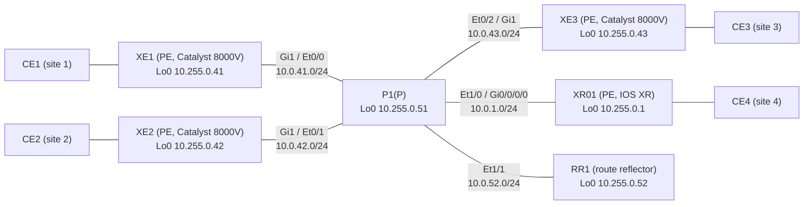

# Question 20261107-005

> **Answer this question without connecting to any device. No additional show commands may be run.**

## Scenario



The core (4 PEs, P1, and RR1) is in AS 65000 and runs IS-IS and LDP. RR1 is the BGP route reflector for VPNv4 and L2VPN EVPN, and each PE has an iBGP session with RR1 only. P1 does not run BGP. Each CE carries the services over 1 link to its PE, separated by VLAN (the CE-facing interface is Gi2 on the XE routers and Gi0/0/0/1 on XR01).

| VLAN | Service | Sites connected |
|---|---|---|
| 100 | L3VPN (VRF A; the LAN of each site is 10.100.<site>.0/24) | 1, 2, 4 |
| 130 | VPWS (LDP pseudowire, pw-id 130) | 1 ⇔ 4 |
| 140 | VPWS (EVPN-VPWS, EVI 140) | 2 ⇔ 3 |
| 200 | EVPN E-LAN (EVI 200, bridge domain 200) | 1, 2, 3 |
| 210 | VPLS (VFI VPLS210, bridge domain 210) | 1, 2, 3 |

The MAC addresses of the CEs are aabb.cc00.8b00 (CE1), aabb.cc00.8c00 (CE2), and aabb.cc00.8d00 (CE3).

The following output was collected on XE1.

```
XE1#show mpls forwarding-table
Local      Outgoing   Prefix           Bytes Label   Outgoing   Next Hop
Label      Label      or Tunnel Id     Switched      interface
16         Pop Label  10.255.0.51/32   0             Gi1        10.0.41.51
17         Pop Label  10.0.1.0/24      0             Gi1        10.0.41.51
18         Pop Label  10.0.42.0/24     0             Gi1        10.0.41.51
19         Pop Label  10.0.43.0/24     0             Gi1        10.0.41.51
20         Pop Label  10.0.52.0/24     0             Gi1        10.0.41.51
21         16         10.255.0.52/32   0             Gi1        10.0.41.51
22         18         10.255.0.42/32   0             Gi1        10.0.41.51
23         19         10.255.0.43/32   0             Gi1        10.0.41.51
24         20         10.255.0.1/32    0             Gi1        10.0.41.51
25         No Label   10.100.1.0/24[V] 2080          Gi2.100    172.16.1.1
26         No Label   l2ckt(1)         606           Gi2        point2point
27         No Label   l2ckt(2)         626           none       point2point
28         No Label   l2ckt(3)         626           none       point2point
29         No Label   evpn(mc:bd 200)  60            none       point2point
30         No Label   evpn(uc:bd 200)  972           none       point2point
```

```
XE1#show l2vpn atom vc
                                       Service
Interface Peer ID         VC ID      Type   Name                     Status
--------- --------------- ---------- ------ ------------------------ ----------
pw100001  10.255.0.1      130        p2p    CE1-CE4                  UP
pw100003  10.255.0.42     210        vfi    VPLS210                  UP
pw100004  10.255.0.43     210        vfi    VPLS210                  UP
```

## Question

Packets with the top labels ① through ④ arrive at XE1. Match each of the labels ① through ④ on the left with one of A through D on the right, which describe how XE1 handles the packet.

### Items to Match

| # | Top label |
|---|------|
| ① | 16 |
| ② | 22 |
| ③ | 25 |
| ④ | 29 |

## Choices

A. Destined to the LAN of site 1 in VRF A. XE1 removes the label and sends it as an IP packet out Gi2.100 to CE1.

B. Destined to the loopback of P1. XE1 removes the label and sends the packet to P1.

C. A broadcast or unknown-destination frame received over EVPN (EVI 200). XE1 floods it toward CE1 in bridge domain 200.

D. Destined to the loopback of XE2. XE1 swaps the label to 18 and sends the packet to P1.
