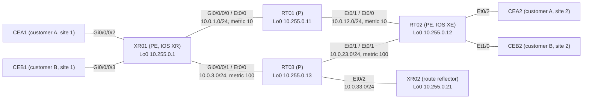

# Question 20261107-006

> **Answer this question without connecting to any device. No additional show commands may be run.**

## Scenario



The core is in AS 65000 and runs IS-IS (with the metrics shown in the diagram) and LDP. XR02 is the VPNv4 route reflector, and XR01 and RT02 have VPNv4 sessions with XR02 only. RT01 and RT03 do not run BGP.

| Site | Attached to | VRF | LAN |
|---|---|---|---|
| Customer A, site 1 (CEA1) | XR01 Gi0/0/0/2 | CUST-A | 10.101.1.0/24 (public segment 198.51.100.0/25) |
| Customer A, site 2 (CEA2) | RT02 Et0/2 | CUST-A | 10.101.2.0/24 (public segment 198.51.100.128/25) |
| Customer B, site 1 (CEB1) | XR01 Gi0/0/0/3 | CUST-B | 10.102.1.0/24 |
| Customer B, site 2 (CEB2) | RT02 Et1/0 | CUST-B | 10.102.2.0/24 |

XR01 also connects to the shared-services servers (VRF SVC, Gi0/0/0/4) and to the Internet (global routing table).

CEB1 pings CEB2 (10.102.2.1) over the L3VPN. The following output was collected at that time (some lines are omitted).

```
RT02#show ip bgp vpnv4 all labels
   Network          Next Hop      In label/Out label
Route Distinguisher: 10.255.0.1:101
   0.0.0.0          10.255.0.1      nolabel/24009
   10.101.1.0/24    10.255.0.1      nolabel/24004
   198.51.100.0/25  10.255.0.1      nolabel/24005
Route Distinguisher: 10.255.0.1:102
   10.102.1.0/24    10.255.0.1      nolabel/24006
Route Distinguisher: 10.255.0.1:900
   10.99.1.0/24     10.255.0.1      nolabel/24007
Route Distinguisher: 10.255.0.12:101 (CUST-A)
   0.0.0.0          10.255.0.1      nolabel/24009
   10.99.1.0/24     10.255.0.1      nolabel/24007
   10.101.1.0/24    10.255.0.1      nolabel/24004
   10.101.2.0/24    172.16.12.2     22/nolabel
   198.51.100.0/25  10.255.0.1      nolabel/24005
   198.51.100.128/25
                   172.16.12.2     23/nolabel
Route Distinguisher: 10.255.0.12:102 (CUST-B)
   10.99.1.0/24     10.255.0.1      nolabel/24007
   10.102.1.0/24    10.255.0.1      nolabel/24006
   10.102.2.0/24    172.16.22.2     24/nolabel
```

```
RT02#show mpls forwarding-table
Local      Outgoing   Prefix           Bytes Label   Outgoing   Next Hop
Label      Label      or Tunnel Id     Switched      interface
16         Pop Label  10.255.0.13/32   0             Et0/1      10.0.23.13
17         19         10.0.3.0/24      0             Et0/0      10.0.12.11
18         Pop Label  10.0.33.0/24     0             Et0/1      10.0.23.13
19         Pop Label  10.255.0.11/32   0             Et0/0      10.0.12.11
20         Pop Label  10.0.1.0/24      0             Et0/0      10.0.12.11
21         20         10.255.0.21/32   0             Et0/1      10.0.23.13
22         No Label   10.101.2.0/24[V] 5230          Et0/2      172.16.12.2
23         No Label   198.51.100.128/25[V]   \
                                       2280          Et0/2      172.16.12.2
24         No Label   10.102.2.0/24[V] 4788          Et1/0      172.16.22.2
25         22         10.255.0.1/32    0             Et0/0      10.0.12.11
```

```
RT01#show mpls forwarding-table
Local      Outgoing   Prefix           Bytes Label   Outgoing   Next Hop
Label      Label      or Tunnel Id     Switched      interface
16         Pop Label  10.255.0.12/32   12438         Et0/1      10.0.12.12
17         Pop Label  10.0.23.0/24     0             Et0/1      10.0.12.12
18         24001      10.255.0.13/32   0             Et0/0      10.0.1.1
           16         10.255.0.13/32   0             Et0/1      10.0.12.12
19         No Label   10.0.3.0/24      0             Et0/0      10.0.1.1
20         18         10.0.33.0/24     0             Et0/1      10.0.12.12
           No Label   10.0.33.0/24     0             Et0/0      10.0.1.1
21         24000      10.255.0.21/32   0             Et0/0      10.0.1.1
           21         10.255.0.21/32   0             Et0/1      10.0.12.12
22         explicit-n 10.255.0.1/32    13260         Et0/0      10.0.1.1
```

## Question

Which MPLS labels does the echo reply carry while it is forwarded on the link from RT02 to RT01? The labels are listed left to right, starting with the outermost (top) label. (Choose one.)

## Choices

A. `25 | 24006`

B. `22 | 24006`

C. `22 | 24`

D. `19 | 24006`
