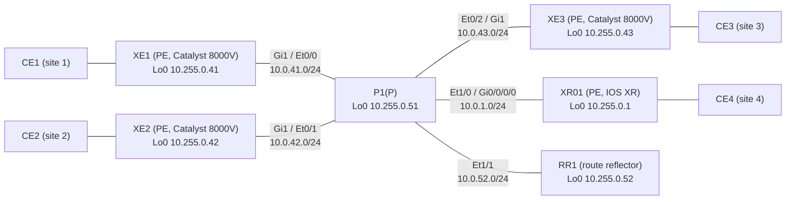

# Question 20261107-007

> **Answer this question without connecting to any device. No additional show commands may be run.**

## Scenario



The core (4 PEs, P1, and RR1) is in AS 65000 and runs IS-IS and LDP. RR1 is the BGP route reflector for VPNv4 and L2VPN EVPN, and each PE has an iBGP session with RR1 only. P1 does not run BGP. Each CE carries the services over 1 link to its PE, separated by VLAN (the CE-facing interface is Gi2 on the XE routers and Gi0/0/0/1 on XR01).

| VLAN | Service | Sites connected |
|---|---|---|
| 100 | L3VPN (VRF A; the LAN of each site is 10.100.<site>.0/24) | 1, 2, 4 |
| 130 | VPWS (LDP pseudowire, pw-id 130) | 1 ⇔ 4 |
| 140 | VPWS (EVPN-VPWS, EVI 140) | 2 ⇔ 3 |
| 200 | EVPN E-LAN (EVI 200, bridge domain 200) | 1, 2, 3 |
| 210 | VPLS (VFI VPLS210, bridge domain 210) | 1, 2, 3 |

The MAC addresses of the CEs are aabb.cc00.8b00 (CE1), aabb.cc00.8c00 (CE2), and aabb.cc00.8d00 (CE3).

CE1 pings CE2 (192.168.200.2) over the EVPN E-LAN. The following output was collected at that time (some lines are omitted).

```
XE1#show l2vpn evpn mac
MAC Address    EVI   BD    ESI                      Ether Tag  Next Hop(s)
-------------- ----- ----- ------------------------ ---------- ---------------
aabb.cc00.8b00 200   200   0000.0000.0000.0000.0000 0          Gi2:200
aabb.cc00.8c00 200   200   0000.0000.0000.0000.0000 0          10.255.0.42
aabb.cc00.8d00 200   200   0000.0000.0000.0000.0000 0          10.255.0.43
```

```
XE1#show bgp l2vpn evpn route-type 2
BGP routing table entry for [2][10.255.0.41:200][0][48][AABBCC008C00][0][*]/20, version 11
Paths: (1 available, best #1, table evi_200)
  Not advertised to any peer
  Refresh Epoch 2
  Local, imported path from [2][10.255.0.42:200][0][48][AABBCC008C00][0][*]/20 (global)
    10.255.0.42 (metric 30) (via default) from 10.255.0.52 (10.255.0.52)
      Origin incomplete, metric 0, localpref 100, valid, internal, best
      EVPN ESI: 00000000000000000000, Label1 30
      Extended Community: RT:65000:200
      Originator: 10.255.0.42, Cluster list: 10.255.0.52
```

```
XE1#show bgp l2vpn evpn route-type 3
BGP routing table entry for [3][10.255.0.41:200][0][32][10.255.0.42]/17, version 4
Paths: (1 available, best #1, table evi_200)
  Flag: 0x100
  Not advertised to any peer
  Refresh Epoch 2
  Local, imported path from [3][10.255.0.42:200][0][32][10.255.0.42]/17 (global)
    10.255.0.42 (metric 30) (via default) from 10.255.0.52 (10.255.0.52)
      Origin incomplete, metric 0, localpref 100, valid, internal, best
      Extended Community: RT:65000:200
      Originator: 10.255.0.42, Cluster list: 10.255.0.52
      PMSI Attribute: Flags:0x0, Tunnel type:IR, length 4, label:29, tunnel identifier: < Tunnel Endpoint: 10.255.0.42 >
```

```
XE1#show mpls forwarding-table
Local      Outgoing   Prefix           Bytes Label   Outgoing   Next Hop
Label      Label      or Tunnel Id     Switched      interface
16         Pop Label  10.255.0.51/32   0             Gi1        10.0.41.51
17         Pop Label  10.0.1.0/24      0             Gi1        10.0.41.51
18         Pop Label  10.0.42.0/24     0             Gi1        10.0.41.51
19         Pop Label  10.0.43.0/24     0             Gi1        10.0.41.51
20         Pop Label  10.0.52.0/24     0             Gi1        10.0.41.51
21         16         10.255.0.52/32   0             Gi1        10.0.41.51
22         18         10.255.0.42/32   0             Gi1        10.0.41.51
23         19         10.255.0.43/32   0             Gi1        10.0.41.51
24         20         10.255.0.1/32    0             Gi1        10.0.41.51
25         No Label   10.100.1.0/24[V] 2080          Gi2.100    172.16.1.1
26         No Label   l2ckt(1)         606           Gi2        point2point
27         No Label   l2ckt(2)         626           none       point2point
28         No Label   l2ckt(3)         626           none       point2point
29         No Label   evpn(mc:bd 200)  60            none       point2point
30         No Label   evpn(uc:bd 200)  972           none       point2point
```

```
P1#show mpls forwarding-table
Local      Outgoing   Prefix           Bytes Label   Outgoing   Next Hop
Label      Label      or Tunnel Id     Switched      interface
16         No Label   10.255.0.52/32   18630         Et1/1      10.0.52.52
17         Pop Label  10.255.0.41/32   14277         Et0/0      10.0.41.41
18         Pop Label  10.255.0.42/32   7446          Et0/1      10.0.42.42
19         Pop Label  10.255.0.43/32   6858          Et0/2      10.0.43.43
20         Pop Label  10.255.0.1/32    5610          Et1/0      10.0.1.1
```

## Question

Which MPLS labels does the echo request carry while it is forwarded on the link from XE1 to P1? The labels are listed left to right, starting with the outermost (top) label. (Choose one.)

## Choices

A. `22 | 30`

B. `18 | 30`

C. `19 | 30`

D. `18`
