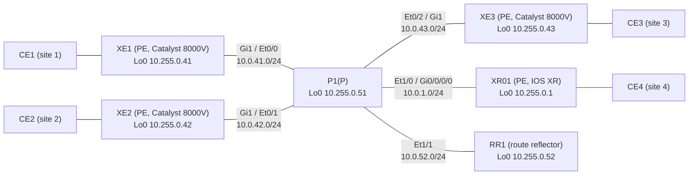

# Question 20261107-010

> **Answer this question without connecting to any device. No additional show commands may be run.**

## Scenario

The core (4 PEs, P1, and RR1) is in AS 65000 and runs IS-IS and LDP. RR1 is the BGP route reflector for VPNv4 and L2VPN EVPN, and each PE has an iBGP session with RR1 only. P1 does not run BGP. Each CE carries the services over 1 link to its PE, separated by VLAN (the CE-facing interface is Gi2 on the XE routers and Gi0/0/0/1 on XR01).

| VLAN | Service | Sites connected |
|---|---|---|
| 100 | L3VPN (VRF A; the LAN of each site is 10.100.<site>.0/24) | 1, 2, 4 |
| 130 | VPWS (LDP pseudowire, pw-id 130) | 1 ⇔ 4 |
| 140 | VPWS (EVPN-VPWS, EVI 140) | 2 ⇔ 3 |
| 200 | EVPN E-LAN (EVI 200, bridge domain 200) | 1, 2, 3 |
| 210 | VPLS (VFI VPLS210, bridge domain 210) | 1, 2, 3 |

The MAC addresses of the CEs are aabb.cc00.8b00 (CE1), aabb.cc00.8c00 (CE2), and aabb.cc00.8d00 (CE3).

CE1 pings CE2 (10.100.2.1) over the L3VPN. An echo request captured on the link between XE1 and P1 carries the labels `18 | 25`, starting with the outermost label.

## Question

Which statement about these two labels is true? (Choose one.)

## Choices

A. When RR1 reflects this route, it replaces the inner label with a value that RR1 allocated.

B. The outer label 18 was allocated by XE2.

C. The inner label 25 was allocated by XE1.

D. When RR1 reflects this route, it changes neither the next hop nor the inner label.
